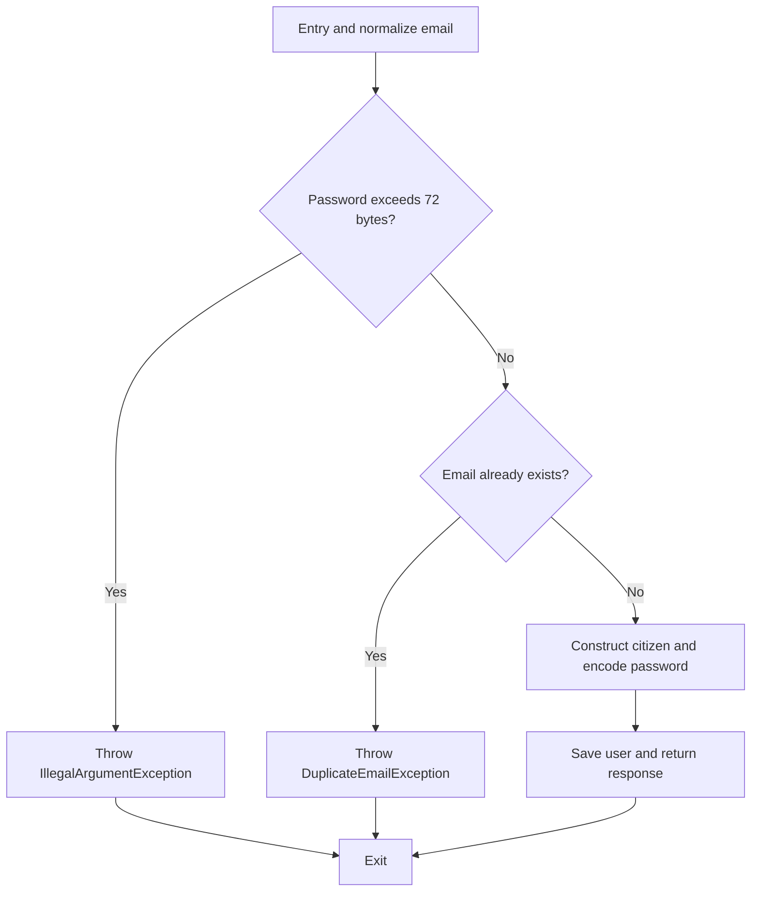
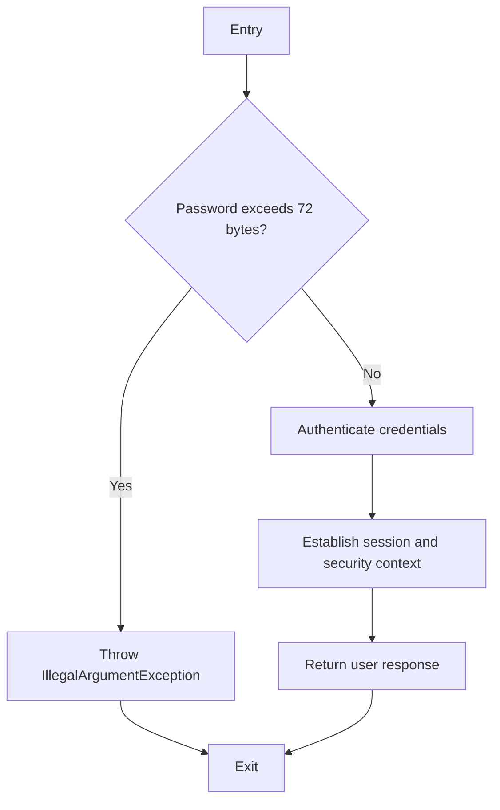

# PublicCare – Member 02: Black-box and White-box Testing

**Module:** EC4206 – Software Testing and Quality Assurance  
**Assignment sections:** 3.3 and 3.4  
**Execution date:** 24 November 2026  
**System under test:** PublicCare, citizen issue reporting and tracking platform  
**Scope:** Isolated Member 2 backend copy; no production system or real user data used.

## 1. Test environment and execution summary

| Item | Configuration |
|---|---|
| Operating system | Windows 11 (build 26300.9974 as shown during setup) |
| IDE | IntelliJ IDEA 2026.3 |
| Java | Microsoft OpenJDK 21.0.13.1 |
| Framework | Spring Boot 3.5.16 |
| Test tools | JUnit 5, Spring MockMvc, Mockito, Spring Security Test, H2 |
| Build tool | Maven Wrapper; Surefire 3.5.6 |
| Coverage tool | JaCoCo 0.8.12 |
| Test level | Backend unit, MVC/API-slice and existing H2 integration tests |

| Run | Tests | Failures | Errors | Skipped | Maven total time | Evidence |
|---|---:|---:|---:|---:|---:|---|
| Baseline | 72 | 0 | 0 | 0 | 13.616 s | E01 |
| After adding title boundary cases | 79 | 0 | 0 | 0 | 10.833 s | E06 |
| After adding registration partitions | 84 | 0 | 0 | 0 | 10.671 s | E07 |
| Final clean run with JaCoCo | 84 | 0 | 0 | 0 | 16.449 s | E08, E09 |

Final pass rate = 84 / 84 × 100 = **100%**. Twelve parameterized test invocations were added (seven BVA and five EP). The measured baseline of 72 is used rather than the 73 test methods mentioned in the earlier planning document. The Maven total time is build/test/report elapsed time, not application response time.

## 3.3 Black-box testing

Black-box testing derives test inputs and expected outputs from requirements, without relying on implementation paths. The selected features are citizen registration, report creation and administrator report deletion. Tests use MockMvc to exercise HTTP status responses, validation and applicable security filters. Service dependencies are mocked in these MVC tests; actual database persistence is not established by these cases.

### 3.3.1 Equivalence Partitioning (EP)

Requirement: **FR-01.1, FR-01.2**. A registration requires a nonblank name (maximum 120 characters), a valid email (maximum 254 characters), and a password of 12–72 characters and at most 72 UTF-8 bytes. The following representative partitions focus on the controller's input validation; the other fields are held valid in each negative case.

| Input | Valid partition | Invalid partition(s) | Representative tests |
|---|---|---|---|
| Password length | 12–72 ASCII characters | 0–11; 73 or more | 16, 8, 73 |
| Email | Nonblank, valid format, within 254 characters | Malformed email | citizen@example.com; invalid-email |
| Full name | Nonblank, within 120 characters | Empty/blank | Test Citizen; empty string |

Other invalid partitions such as overlong names and email addresses are not independently executed in this added EP set. The separate existing service test for a multibyte password exceeding 72 bytes passed in the baseline; the new ASCII length cases do not test that byte-limit rule independently.

**Derived test cases and actual results**

Preconditions: valid CSRF token, JSON request to `POST /api/auth/register`; mock registration service returns a citizen response for the valid case. Passwords consist of synthetic repeated ASCII `A` characters.

| ID | Requirement | Feature | Input / condition | Expected HTTP | Actual HTTP* | Status | Evidence |
|---|---|---|---|---:|---:|---|---|
| EP-01 | FR-01.1, FR-01.2 | Registration | Test Citizen; citizen@example.com; 16 characters | 201 | 201 | PASS | E07, E08 |
| EP-02 | FR-01.2 | Registration | Valid name/email; 8 characters | 400 | 400 | PASS | E07, E08 |
| EP-03 | FR-01.2 | Registration | Valid name/email; 73 characters | 400 | 400 | PASS | E07, E08 |
| EP-04 | FR-01.2 | Registration | Valid name/password; invalid-email | 400 | 400 | PASS | E07, E08 |
| EP-05 | FR-01.2 | Registration | Empty name; valid email/password | 400 | 400 | PASS | E07, E08 |

\*Actual statuses are established by the passing parameterized HTTP-status assertions, not by a separately captured HTTP traffic trace.

Implementation: `registrationEquivalencePartitionTest` in [AuthControllerTest.java](../project/backend/src/test/java/lk/publiccare/backend/auth/AuthControllerTest.java). All five invocations passed. Validation source: [AuthDtos.java](../project/backend/src/main/java/lk/publiccare/backend/auth/AuthDtos.java).

### 3.3.2 Boundary Value Analysis (BVA)

Requirement: **FR-03.1, FR-03.2**. A report title is nonblank and has a maximum of 160 characters. With nonblank ASCII strings, the valid length interval is 1–160.

| Boundary | Just below | At boundary | Just above |
|---|---:|---:|---:|
| Minimum (1) | 0 | 1 | 2 |
| Maximum (160) | 159 | 160 | 161 |

An interior representative length of 80 is also included. All other report fields are valid and constant.

Preconditions: authenticated citizen, valid CSRF token, `POST /api/reports`; description `Description`, category `Road damage`, location `Galle`. Title is repeated ASCII `A`. For valid inputs, the mocked report service returns a pending report.

| ID | Requirement | Feature | Title length | Expected HTTP | Actual HTTP* | Status | Evidence |
|---|---|---|---:|---:|---:|---|---|
| BVA-01 | FR-03.2 | Report creation | 0 | 400 | 400 | PASS | E06, E08 |
| BVA-02 | FR-03.1, FR-03.2 | Report creation | 1 | 201 | 201 | PASS | E06, E08 |
| BVA-03 | FR-03.1, FR-03.2 | Report creation | 2 | 201 | 201 | PASS | E06, E08 |
| BVA-04 | FR-03.1, FR-03.2 | Report creation | 80 | 201 | 201 | PASS | E06, E08 |
| BVA-05 | FR-03.1, FR-03.2 | Report creation | 159 | 201 | 201 | PASS | E06, E08 |
| BVA-06 | FR-03.1, FR-03.2 | Report creation | 160 | 201 | 201 | PASS | E06, E08 |
| BVA-07 | FR-03.2 | Report creation | 161 | 400 | 400 | PASS | E06, E08 |

\*Actual statuses are established by passing HTTP-status assertions.

Implementation: `reportTitleBoundaryTest` in [ReportControllerTest.java](../project/backend/src/test/java/lk/publiccare/backend/report/ReportControllerTest.java). All seven invocations passed. Validation source: [ReportDtos.java](../project/backend/src/main/java/lk/publiccare/backend/report/ReportDtos.java). The length tests do not claim to cover every other field boundary.

### 3.3.3 Decision Table Testing

Feature: administrator report deletion, `DELETE /api/admin/reports/51`. Relevant requirements: **FR-02.1** (CSRF), **FR-02.8** (authorization), **FR-08.1** (administrator deletion), **FR-08.5** (citizens cannot delete). The existing `onlyAuthenticatedAdminsCanDeleteReportsAndDeleteRequiresCsrf` test executes four combinations and verifies the deletion service is invoked only for the authorized request.

| Conditions / actions | R1 | R2 | R3 | R4 | R5 | R6 |
|---|---|---|---|---|---|---|
| Authenticated | Yes | No | Yes | Yes | No | Yes |
| Admin role | Yes | N/A | No | Yes | N/A | No |
| Valid CSRF | Yes | Yes | Yes | No | No | No |
| Allow deletion | Yes | No | No | No | No | No |
| Expected HTTP status | 204 | 401 | 403 | 403 | 403 | 403 |
| Executed in selected test | Yes | Yes | Yes | Yes | No | No |

The last two rules are proposed based on the CSRF requirement and filter ordering; they were not independently verified by the selected test.

| ID | Requirement | Feature | Input / condition | Expected HTTP | Actual HTTP* | Status | Evidence |
|---|---|---|---|---:|---:|---|---|
| DT-01 | FR-08.1 | Delete report | Admin, valid CSRF | 204 | 204 | PASS | E01, E08, E10 |
| DT-02 | FR-02.8 | Delete report | Anonymous, valid CSRF | 401 | 401 | PASS | E01, E08, E10 |
| DT-03 | FR-02.8, FR-08.5 | Delete report | Citizen, valid CSRF | 403 | 403 | PASS | E01, E08, E10 |
| DT-04 | FR-02.1 | Delete report | Admin, no CSRF | 403 | 403 | PASS | E01, E08, E10 |
| DT-05 | FR-02.1 | Delete report | Anonymous, no CSRF | 403 | — | NOT EXECUTED | — |
| DT-06 | FR-02.1, FR-08.5 | Delete report | Citizen, no CSRF | 403 | — | NOT EXECUTED | — |

\*Four passing assertions are part of one existing JUnit test method, not four additional Maven test invocations. Service interaction is mocked; this is not proof that real PostgreSQL records are deleted. Source: [ReportControllerTest.java](../project/backend/src/test/java/lk/publiccare/backend/report/ReportControllerTest.java).

## 3.4 White-box testing

White-box testing uses the internal logic of backend methods to identify execution paths and measure coverage. The selected methods are `AuthService.register()` and `AuthController.login()`.

### 3.4.1 Control-flow graphs and Cyclomatic Complexity

For a connected control-flow graph, V(G) = E − N + 2, or decision points + 1 for the simplified binary-decision graphs used here. To match JaCoCo's complexity convention, exception-handler edges are excluded from the counted graph. The exception paths are nevertheless documented separately because they are meaningful test cases.

#### Method A: AuthService.register()

Source: [AuthService.java](../project/backend/src/main/java/lk/publiccare/backend/auth/AuthService.java).



Nodes N = 8; edges E = 9; decision points = 2.

V(G) = 9 − 8 + 2 = 3.  
V(G) = 2 + 1 = **3**, matching JaCoCo (E04).

| Path | Execution sequence | Existing test | Observed |
|---|---|---|---|
| A1 | A → B → C → H | `passwordExceedingBcryptByteLimitIsRejected` | PASS |
| A2 | A → B → D → E → H | `duplicateEmailIsRejectedBeforeSaving` | PASS |
| A3 | A → B → D → F → G → H | `registrationNormalizesEmailHashesPasswordAndForcesCitizenRole` | PASS |

The separate `DataIntegrityViolationException` catch converts a concurrent duplicate save failure into `DuplicateEmailException`. That exception-handler path was not exercised by the existing selected service tests. JaCoCo does not count exception handlers as branches; consequently, 100% branch coverage does not mean that this method has complete exception-path coverage.

#### Method B: AuthController.login()

Source: [AuthController.java](../project/backend/src/main/java/lk/publiccare/backend/auth/AuthController.java).



Nodes N = 7; edges E = 7; decision points = 1.

V(G) = 7 − 7 + 2 = 2.  
V(G) = 1 + 1 = **2**, matching JaCoCo (E05).

| Path | Execution sequence | Test / evidence | Observed |
|---|---|---|---|
| B1 | A → B → C → G | No selected login test sends a password exceeding 72 UTF-8 bytes while passing DTO validation | NOT EXECUTED |
| B2 | A → B → D → E → F → G | `loginPersistsSessionAndMeUsesThatSession` | PASS |

An additional exception path occurs when authentication throws `AuthenticationException`; it is converted into `InvalidCredentialsException`. `invalidLoginReturnsGenericUnauthorizedMessage` exercised that path, expecting HTTP 401 and a generic error message. The exception path is not included in the JaCoCo branch count.

### 3.4.2 Statement coverage

Statement coverage = executed executable statements / total executable statements × 100.

JaCoCo measures bytecode instructions and source lines rather than directly counting Java source statements. The following selected-method statement counts are a manual trace-based measurement using the executed tests, with an explicit counting convention: count executable assignments/declarations with initialization, method-call statements, returns and throws; exclude control headers, braces and comments; count multiline statements once.

| Method | Executed action statements (identified from source and passing tests) | Unexecuted action statement | Manual statement coverage |
|---|---|---|---:|
| `AuthService.register()` | Normalize email; throw on excess bytes; throw on duplicate; construct citizen; return saved response | Throw duplicate exception in save-error handler | 5/6 = 83.33% |
| `AuthController.login()` | Assign authentication; throw invalid credentials; invoke session strategy; create context; set context authentication; set holder context; save context; return user response | Throw on excess password bytes | 8/9 = 88.89% |

These are source-level trace counts under the stated convention, not a separate tool-generated statement counter or a claim about full-project exact statement coverage.

For reproducible tool-based evidence, the measured JaCoCo line coverage is reported as a **proxy** for statement coverage; a line may contain multiple statements or only part of one.

| Scope | Covered lines | Total lines | Line coverage |
|---|---:|---:|---:|
| Entire backend | 433 | 641 | 67.55% |
| Authentication package | 40 | 48 | 83.33% |
| `AuthService.register()` | 7 | 9 | 77.78% |
| `AuthController.login()` | 12 | 13 | 92.31% |

Package and method details are from baseline evidence E03–E05. The final project-wide line counts are from E09.

### 3.4.3 Branch coverage

Branch coverage = executed decision branches / total decision branches × 100.

| Scope | Covered branches | Total branches | Branch coverage |
|---|---:|---:|---:|
| Entire backend | 126 | 302 | 41.72% |
| Authentication package | 5 | 6 | 83.33% |
| `AuthService.register()` | 4 | 4 | 100% |
| `AuthController.login()` | 1 | 2 | 50% |

Method/package results are from baseline E03–E05. The two registration `if` conditions both had true and false outcomes executed. The login password-byte-limit condition had only its false outcome executed. The final backend report (E09) displays 41% branch coverage; the exact count-based value is 41.72%.

### 3.4.4 Baseline versus final coverage

| Metric | Baseline (72 tests) | Final (84 tests) |
|---|---:|---:|
| Instructions | 2,536 / 4,226 (60.01%) | 2,536 / 4,226 (60.01%) |
| Lines | 433 / 641 (67.55%) | 433 / 641 (67.55%) |
| Branches | 126 / 302 (41.72%) | 126 / 302 (41.72%) |
| Methods | 170 / 237 (71.73%) | 170 / 237 (71.73%) |
| Classes with executed code | 51 / 57 (89.47%) | 51 / 57 (89.47%) |

The new parameterized tests increase input-value coverage but did not increase measured backend code coverage. They primarily exercise validation and MVC routes that had already been executed. The final pass rate is therefore not equivalent to complete code or requirement coverage.

### 3.4.5 Tool configuration and reproducibility

JaCoCo 0.8.12 was executed successfully on Java 21 through Maven without editing `pom.xml`. The build analyzed 57 classes and generated an HTML report. Open a terminal configured with Java 21 in `project/backend`, or use IntelliJ Maven with the project JDK.

Baseline Maven goal:

```powershell
.\mvnw.cmd test
```

Final coverage command (Windows):

```powershell
.\mvnw.cmd clean org.jacoco:jacoco-maven-plugin:0.8.12:prepare-agent test org.jacoco:jacoco-maven-plugin:0.8.12:report
```

Equivalent IntelliJ Run Anything command used during testing:

```text
mvn clean org.jacoco:jacoco-maven-plugin:0.8.12:prepare-agent test org.jacoco:jacoco-maven-plugin:0.8.12:report
```

Generated coverage: `project/backend/target/site/jacoco/index.html`  
Generated per-test logs: `project/backend/target/surefire-reports/`

Only the two existing test classes were extended; no production code or Maven build configuration was intentionally changed. The generated `target` directory is build output, not source code.

## 4. Findings and limitations

- All 84 executed test invocations passed; no failures, errors or skipped tests were reported by the final Maven run.
- All twelve added EP/BVA cases passed. Four decision-table rules were checked within one existing automated test.
- The 41.72% overall branch coverage indicates substantial untested decision outcomes. Priority improvements include the login byte-limit rejection (e.g. a multibyte password within the DTO character limit), concurrent duplicate-registration handling, and additional report/admin paths.
- The report package has 39% displayed branch coverage; the authentication package has 83%. Security package instruction coverage is 33%. Low coverage is a testing gap, not by itself a confirmed software defect.
- MVC tests mock services and do not establish full browser, live PostgreSQL, or end-to-end persistence behavior. The existing H2 integration test is not a substitute for production PostgreSQL validation.
- Decision-table rules DT-05 and DT-06 are not claimed as executed; no unexecuted case is included in the 84-test pass rate.
- No application defect is claimed solely from low coverage. The baseline log includes an intentionally triggered deletion-failure scenario whose test passed.

## 5. Evidence index

| ID | File | Purpose |
|---|---|---|
| E01 | [01_Baseline_Test_Results.png](../evidence/01_Baseline_Test_Results.png) | Initial 72-test result |
| E02 | [02_JaCoCo_Coverage.png](../evidence/02_JaCoCo_Coverage.png) | Baseline overall coverage |
| E03 | [03_Authentication_Coverage.png](../evidence/03_Authentication_Coverage.png) | Authentication package coverage |
| E04 | [04_AuthService_Method_Coverage.png](../evidence/04_AuthService_Method_Coverage.png) | Registration method complexity and coverage |
| E05 | [05_AuthController_Method_Coverage.png](../evidence/05_AuthController_Method_Coverage.png) | Login method complexity and coverage |
| E06 | [06_Boundary_Value_Test_Results.png](../evidence/06_Boundary_Value_Test_Results.png) | 79-test run after BVA additions |
| E07 | [07_Equivalence_Partitioning_Results.png](../evidence/07_Equivalence_Partitioning_Results.png) | 84-test run after EP additions |
| E08 | [08_Final_Test_Execution.png](../evidence/08_Final_Test_Execution.png) | Final clean test and coverage generation |
| E09 | [09_Final_Coverage_Report.png](../evidence/09_Final_Coverage_Report.png) | Final coverage metrics |
| E10 | [10_Baseline_Maven_Log.txt](../evidence/10_Baseline_Maven_Log.txt) | Original baseline Maven output |

**Requirement references:** [Member instructions](../MEMBER_TASKS.md), [Requirements and RTM](PART01_REQUIREMENTS_AND_RTM.md), [Test plan and STLC](PART01_TEST_PLAN_AND_STLC.md).
